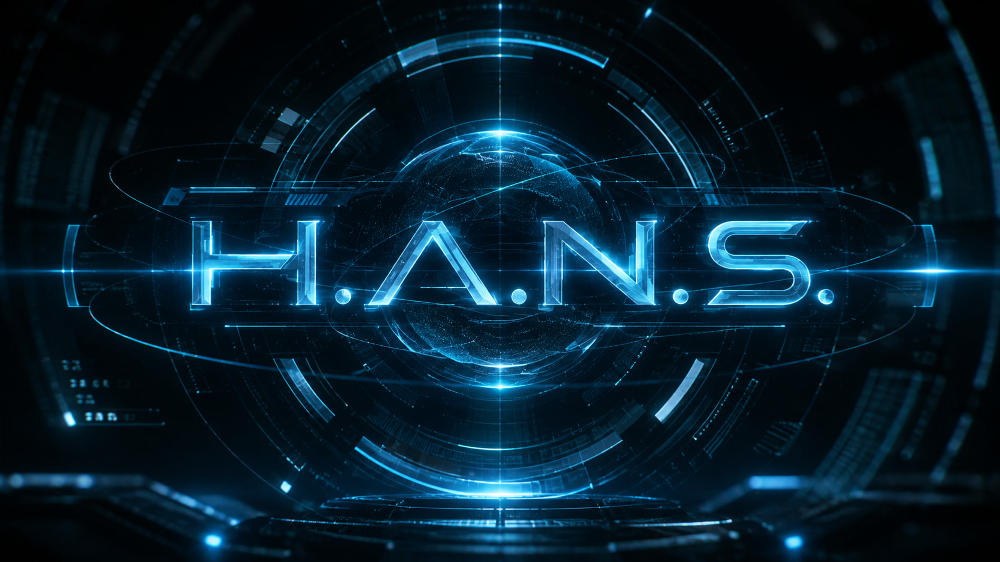

<p align="center">
  
</p>

<p align="center">
  <em>An intelligent AI companion that thinks ahead, takes initiative, and turns foresight into action.</em>
</p>

---

## What is H.A.N.S. ?

H.A.N.S. is a personal AI assistant, inspired by the vision of Jarvis. Rather than waiting for you to ask, Hans stays one step ahead: monitoring what matters, understanding what deserves your attention, and proactively reaching out through the apps you already use. Intelligent, intuitive, and always one step ahead.

- **Proactive.** Reacts to events (an important email you haven't read, a calendar change, a reminder) instead of only answering questions.
- **Everywhere.** Chat with the same Hans from the web app or your phone's messaging apps.
- **LLM-agnostic.** Swap between cloud and local models without rewriting anything.
- **Extensible.** New abilities plug in as MCP servers.
- **You stay in control.** Anything that acts on your behalf asks first.

## How it works

```
  Triggers  ──►  Event bus  ──►  Triage  ──►  Agent  ──►  Channels
  (email,         (queue)        (is this                 (web, chat
   calendar,                      important?)              apps, push)
   schedules,                                    ▲
   heartbeat)                                    │
                          You reply ─────────────┘
```

1. **Triggers** turn the outside world into events: incoming mail, webhooks, schedules, and a periodic "heartbeat" where Hans checks whether anything needs your attention.
2. **Triage** uses a fast, cheap model to filter the noise. Only things that matter wake up the full agent.
3. **The agent** reasons, uses tools, remembers your preferences, and decides what to do.
4. **Channels** deliver the result, with quick actions you can approve or dismiss in one tap.

## Tech stack

| Layer | Tools |
|---|---|
| Agent | LangGraph |
| Models | Any provider: cloud or local |
| Tools | Model Context Protocol (MCP) |
| Backend | FastAPI, Python |
| Frontend | Next.js, React, Tailwind |
| Data | Postgres (+ vector search), Redis |
| Observability | Tracing & evals |

## Project structure

```
hans/
├── backend/    # FastAPI service, agent, workers, integrations
└── frontend/   # Next.js web app & dashboard
```

## Roadmap

- [ ] Core agent with web chat
- [ ] Messaging app integration
- [ ] Event triggers, scheduler & heartbeat
- [ ] Email awareness
- [ ] Long-term memory & preferences
- [ ] Tracing & evals
- [ ] Voice

## Status

🚧 Early development.
